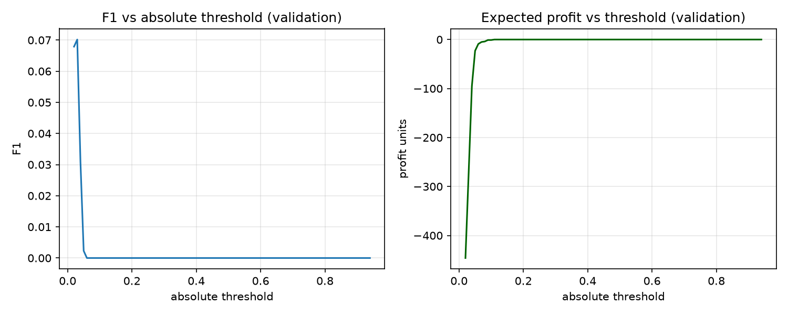
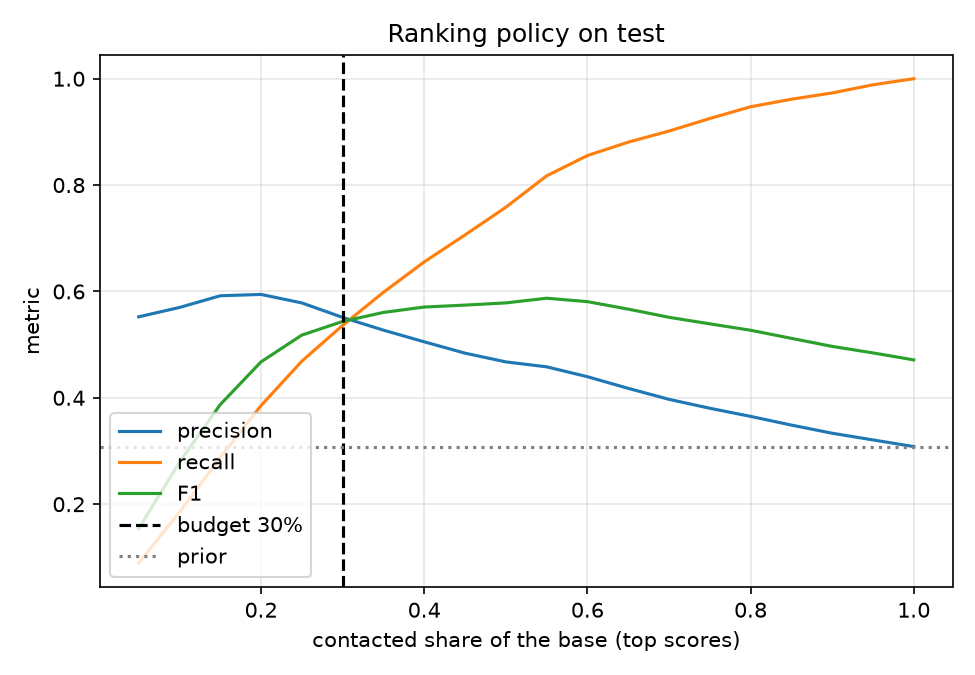
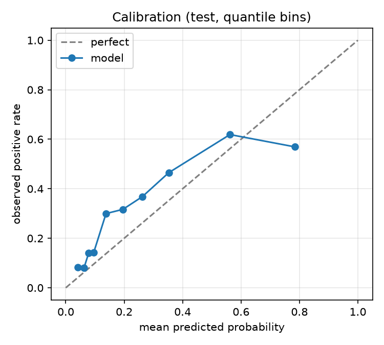
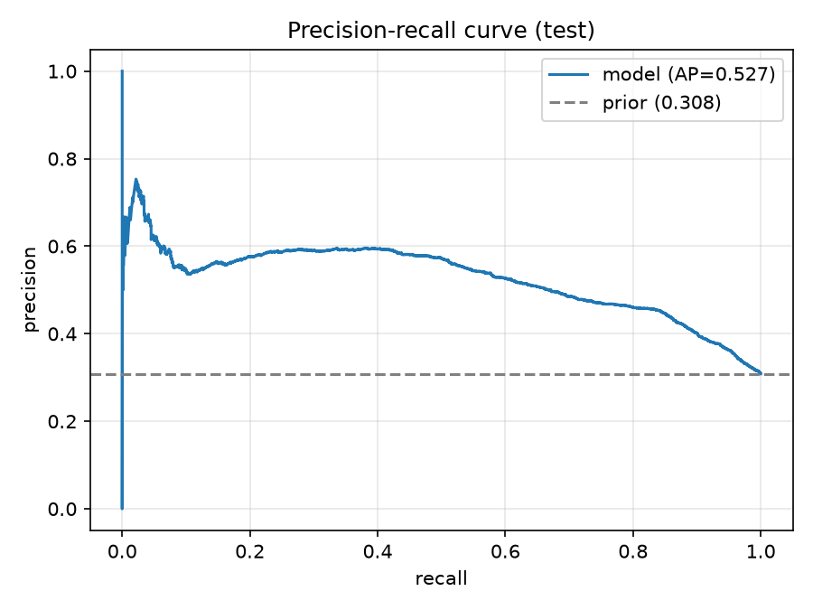
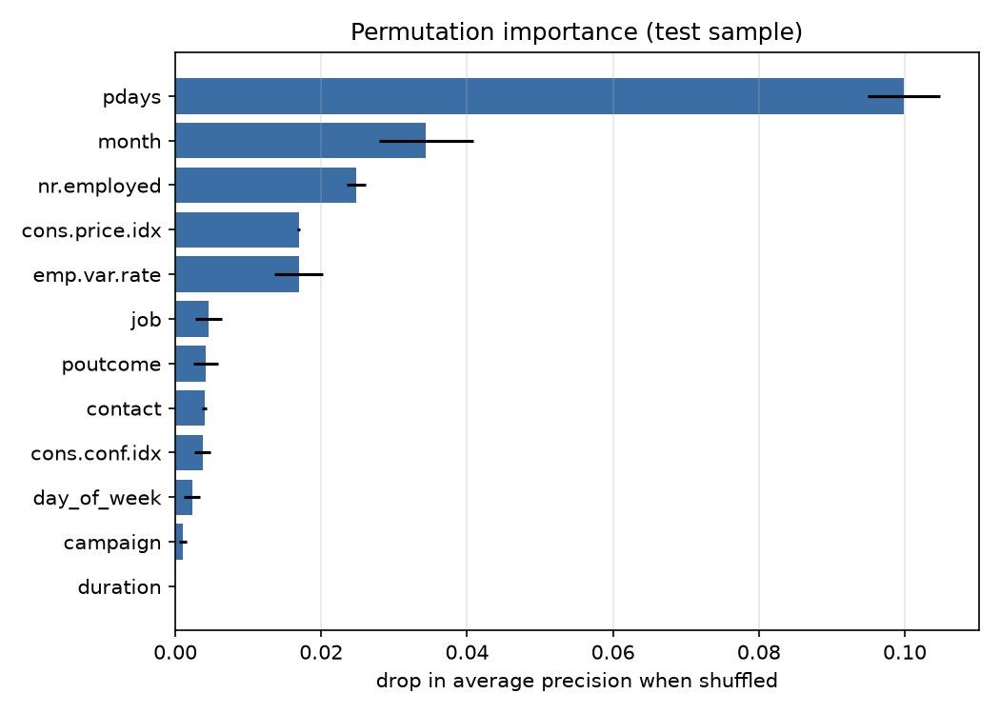

# Bank Marketing: прогноз отклика на телемаркетинг

Отчёт сгенерирован автоматически командой `uv run python -m bank_marketing.cli all`. Датасет: UCI Bank Marketing (bank-additional-full), sha256 `74adfc578bf77a7f…`.

## 1. Итог

| Показатель | Значение |
|---|---|
| Выбранная модель | `logreg` |
| Правило выбора | максимальный ROC-AUC на последних 20% train (validation) |
| PR-AUC на test | 0.527 |
| ROC-AUC на test | 0.748 |
| Brier на test | 0.191 |
| Доля `yes` на test | 30.8% |
| PR-AUC / prior | ×1.71 |
| Precision при бюджете 30% | 0.551 |
| Recall при том же бюджете | 0.536 |
| F1 при том же бюджете | 0.543 |
| F1 «звонить всем» | 0.471 |
| Precision случайного отбора | 0.308 |

Главная цифра — не PR-AUC, а **precision при фиксированном бюджете звонков**: модель поднимает долю согласий с 30.8% (случайный отбор) до 55.1% на том же числе контактов. PR-AUC ниже, чем в учебниках, потому что test — это 2010 год с другой долей согласий (см. раздел 3), а не случайная выборка из тех же лет.

## 2. Данные

- Строк: **41188**, колонок: **21**.
- Доля `y == yes` во всём файле: **11.27%**.
- Полных дубликатов строк: **12** (не удалялись, чтобы не менять распределение; см. `ASSUMPTIONS.md`).

| Окно | Строк | Доля `yes` |
|---|---|---|
| train (2008-05 … 2010-04) | 32950 | 6.4% |
|   из него development | 26360 | — |
|   из него validation | 6590 | 12.7% |
| test (2010-05 … 2010-11) | 8238 | 30.8% |

Пропуски закодированы строкой `unknown`, а не NaN:

| Колонка | `unknown` |
|---|---|
| job | 330 |
| marital | 80 |
| education | 1731 |
| default | 8597 |
| housing | 990 |
| loan | 990 |

## 3. Дрейф и сплит

Доля согласий растёт по годам: 4.8% в development, 12.7% в validation и 30.8% на test. Это не ошибка сплита, а свойство кампании 2010 года. Отсюда два следствия: абсолютные вероятности плохо переносятся между окнами, а случайная кросс-валидация завышает качество.

| Схема валидации внутри train | PR-AUC |
|---|---|
| TimeSeriesSplit (production-like) | 0.086 |
| StratifiedKFold shuffle (наивная) | 0.206 |

Разрыв **+0.119** PR-AUC. Случайный сплит перемешивает месяцы и позволяет модели выучить режим, которого в будущем не будет. Поэтому все решения принимаются только по времени вперёд.

## 4. Сравнение моделей

**TimeSeriesSplit по всему train (2008–2010/04):**

| Модель | PR-AUC | ROC-AUC | Brier |
|---|---|---|---|
| `dummy_prior` | 0.071 ± 0.036 | 0.500 | 0.066 |
| `logreg` | 0.086 ± 0.061 | 0.539 | 0.133 |
| `hist_gbdt` | 0.076 ± 0.047 | 0.498 | 0.067 |
| `lightgbm` | 0.075 ± 0.046 | 0.499 | 0.068 |

В этом окне доля согласий 5–6%, и все модели близки к случайному ранжированию: сигнал почти весь приходится на смену режима 2010 года. Это честная картина сложности задачи, а не баг.

**Последние 20% train (validation, 2009-11 … 2010-04):**

| Модель | PR-AUC | ROC-AUC | Brier |
|---|---|---|---|
| `dummy_prior` | 0.127 | 0.500 | 0.117 |
| `logreg` | 0.136 | 0.575 | 0.127 |
| `hist_gbdt` | 0.134 | 0.544 | 0.119 |
| `lightgbm` | 0.148 | 0.560 | 0.118 |

Выбор сделан по ROC-AUC на validation: highest ROC-AUC on the last 20% of the training window. ROC-AUC не зависит от доли положительного класса и поэтому устойчивее PR-AUC при таком дрейфе. Разницы между моделями лежат в пределах шума — это отдельный вывод, а не повод выбирать по test.

## 5. Утечка `duration`

| Модель | Без `duration` | С `duration` | Δ |
|---|---|---|---|
| `logreg` | 0.086 | 0.402 | +0.315 |
| `hist_gbdt` | 0.076 | 0.456 | +0.379 |

`duration` — длительность последнего звонка. В момент, когда нужно решить, кому звонить, этого значения ещё не существует, поэтому признак исключён из продакшн-модели. Цифры показывают цену честной постановки: с ним PR-AUC вырастает в разы. Тест `tests/test_leakage_guard.py` не даст вернуть его случайно.

## 6. Порог против бюджета

| Политика | Порог на validation | Контактов на test | Precision | Recall | F1 | Прибыль |
|---|---|---|---|---|---|---|
| max F1 (абсолютный порог) | 0.03 | 8172 | 0.311 | 1.000 | 0.474 | 17218 |
| max прибыли (абсолютный порог) | 0.11 | 4919 | 0.442 | 0.856 | 0.583 | 16811 |
| top 30% по score | 70-й процентиль | 2472 | 0.551 | 0.536 | 0.543 | 11148 |

Абсолютный порог, подобранный на validation, переносится плохо: доля согласий выросла, и тот же порог на test зовёт почти всех (max F1) или 60% базы (max прибыли). Поэтому операционная политика — **фиксированный бюджет контактов**: берём верхние 30% по score, а порог пересчитывается как 70-й процентиль score каждой партии.

Насколько это разные числа: порог бюджетной политики на validation — 0.0001, на test — 0.2982. Одна и та же политика требует совершенно разных абсолютных значений, и это ещё один аргумент за квантиль.

F1 и прибыль растут вместе с числом контактов, поэтому сравнивать политики по F1 при разном объёме нельзя. Корректное сравнение — precision при одинаковом объёме: на 30% бюджета модель даёт 0.551 против 0.308 у случайного отбора (×1.79).

При допущении «звонок = 1, конверсия = +10» каждый контакт прибылен, поэтому без ограничения мощности оптимум — звонить всем. Модель нужна именно при фиксированной пропускной способности: она концентрирует согласия в верхушке списка.





Для сравнения: «звонить всем» даёт F1 0.471 при 8238 контактах, а случайные 30% — F1 0.304.

## 7. Калибровка



Brier score на test: **0.191**. Кривая калибровки показывает, можно ли трактовать выход как вероятность. При таком дрейфе вероятности смещены, поэтому порог задаётся квантилем score, а не абсолютным числом; post-hoc калибровка по историческому окну здесь не поможет.

## 8. Анализ ошибок



### Важность признаков



| Признак | Δ average precision |
|---|---|
| `pdays` | 0.0999 |
| `month` | 0.0344 |
| `nr.employed` | 0.0248 |
| `cons.price.idx` | 0.0169 |
| `emp.var.rate` | 0.0169 |
| `job` | 0.0046 |
| `poutcome` | 0.0042 |
| `contact` | 0.0040 |
| `cons.conf.idx` | 0.0037 |
| `day_of_week` | 0.0023 |

### Срез: `month`

| Значение | N | Доля yes | PR-AUC | Precision | Recall |
|---|---|---|---|---|---|
| may | 3486 | 13.0% | 0.340 | 0.584 | 0.161 |
| aug | 1003 | 38.3% | 0.599 | 0.591 | 0.482 |
| jun | 944 | 39.3% | 0.538 | 0.542 | 0.447 |
| oct | 651 | 41.9% | 0.573 | 0.419 | 1.000 |
| sep | 570 | 44.9% | 0.674 | 0.544 | 0.801 |
| jul | 489 | 49.5% | 0.672 | 0.681 | 0.529 |
| nov | 485 | 46.6% | 0.661 | 0.665 | 0.509 |
| mar | 264 | 56.8% | 0.740 | 0.654 | 0.793 |

### Срез: `job`

| Значение | N | Доля yes | PR-AUC | Precision | Recall |
|---|---|---|---|---|---|
| admin. | 2382 | 33.3% | 0.541 | 0.585 | 0.552 |
| blue-collar | 1295 | 16.7% | 0.396 | 0.508 | 0.301 |
| technician | 1166 | 32.3% | 0.541 | 0.554 | 0.515 |
| retired | 730 | 44.0% | 0.541 | 0.528 | 0.682 |
| services | 644 | 22.5% | 0.505 | 0.589 | 0.386 |
| student | 528 | 40.7% | 0.592 | 0.542 | 0.758 |
| management | 524 | 32.3% | 0.563 | 0.586 | 0.544 |
| self-employed | 265 | 25.7% | 0.415 | 0.456 | 0.456 |

### Срез: `age_bin`

| Значение | N | Доля yes | PR-AUC | Precision | Recall |
|---|---|---|---|---|---|
| 31-40 | 2846 | 27.2% | 0.518 | 0.546 | 0.484 |
| 18-30 | 2268 | 29.9% | 0.528 | 0.542 | 0.571 |
| 41-50 | 1332 | 28.2% | 0.550 | 0.599 | 0.500 |
| 51-60 | 1020 | 34.7% | 0.529 | 0.542 | 0.525 |
| 60+ | 767 | 46.4% | 0.537 | 0.547 | 0.632 |

### Срез: `unknown_count`

| Значение | N | Доля yes | PR-AUC | Precision | Recall |
|---|---|---|---|---|---|
| 0 | 7038 | 31.4% | 0.531 | 0.555 | 0.541 |
| 1 | 938 | 25.7% | 0.484 | 0.504 | 0.515 |
| 2 | 235 | 33.2% | 0.580 | 0.603 | 0.487 |

### Худшие ошибки

**False positives** (модель звала, клиент отказался):

| P(yes) | Возраст | Job | Месяц | Кампания |
|---|---|---|---|---|
| 0.9829 | 23 | student | oct | 1 |
| 0.9765 | 65 | retired | oct | 5 |
| 0.9729 | 74 | retired | oct | 2 |
| 0.9715 | 28 | admin. | oct | 1 |
| 0.9687 | 81 | retired | oct | 2 |

**False negatives** (модель молчала, клиент согласился):

| P(yes) | Возраст | Job | Месяц | Кампания |
|---|---|---|---|---|
| 0.0263 | 54 | blue-collar | may | 3 |
| 0.0304 | 51 | blue-collar | may | 1 |
| 0.0309 | 29 | blue-collar | may | 1 |
| 0.0312 | 33 | unemployed | may | 1 |
| 0.0328 | 37 | services | may | 1 |

## 9. Ограничения

- Один временной holdout (2010-05 … 2010-11). Доверительных интервалов нет; для решения о запуске нужен bootstrap по месяцам.
- Данные 2008–2010 годов; рынок и продукты изменились, метрики не переносятся на сегодняшний день без переобучения.
- Модель использует `month` и макроэкономические признаки как прокси времени. На 2010 году это помогает, но за его пределами ранжирование деградирует.
- Бюджет 30% — допущение о пропускной способности колл-центра, а не измеренный факт.
- `duration` исключён, поэтому качество ниже ноутбуков, где он есть. Это осознанная цена честной постановки.

## 10. Воспроизведение

```bash
uv sync
uv run python -m bank_marketing.cli all
uv run pytest -q
uv run ruff check .
```

Seed: 42. Полные метрики — в `reports/metrics.json`, версии окружения и хеш данных — в `reports/run.json`.
